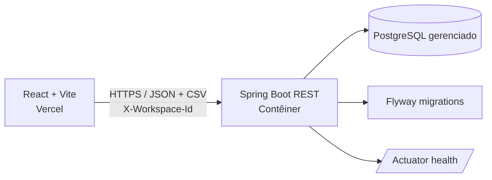

# LedgerLens

> **Conciliação financeira mais clara.** O LedgerLens importa lançamentos de um ERP e de um extrato bancário, aplica regras explícitas de correspondência e apresenta itens conciliados, divergentes e ausentes.

[](https://github.com/Willitonlima/ledgerlens/actions/workflows/verify.yml)

**Demo:** [Adicionar URL pública da demonstração](https://example.com)  
**Imagens:** substitua os marcadores abaixo por capturas sem dados financeiros reais.

| Visão geral | Resultado da conciliação |
|---|---|
| `` | `` |

## O que o projeto faz

- Importa CSVs de ERP e banco, valida os registros e associa cada importação ao workspace atual.
- Concilia os lotes mais recentes de cada origem e mostra correspondências, divergências e lançamentos sem par.
- Filtra/pagina resultados e exporta CSV com proteção contra fórmulas.
- Permite excluir os dados do workspace atual; os dados também expiram conforme a política de retenção.

## Arquitetura



O frontend é uma SPA estática. Em produção, `VITE_API_URL` aponta para a origem do backend; localmente, o Vite encaminha `/api` para `localhost:8080`. O backend usa Spring Data JPA, Flyway e PostgreSQL. `docker-compose.yml` fornece somente o PostgreSQL para desenvolvimento local.

## Stack e estrutura

- **Backend:** Java 25 LTS conforme `backend/pom.xml`, Spring Boot 4.0.9 (Spring Framework 7.0.10), Maven, JPA, Flyway, PostgreSQL.
- **Frontend:** React, Vite, Tailwind CSS, npm, Vitest e Testing Library.
- **Testes backend:** JUnit/Spring Boot Test e Testcontainers; os testes de integração precisam de Docker.
- **Fontes:** Newsreader e Public Sans empacotadas localmente, sem buscar fontes de terceiros em runtime.

```text
backend/src/main/java/com/ledgerlens/
├── domain/           # entidades e enums
├── application/      # importação, validação e conciliação
├── infrastructure/   # persistência Spring Data
├── presentation/     # REST e tratamento de erros
└── config/           # CORS, workspace e propriedades
frontend/src/
├── api/              # cliente HTTP e workspace
├── components/       # importação, métricas e resultados
├── hooks/
└── utils/
```

## Regras de conciliação e valores

1. A execução usa o lote mais recente do ERP e o lote mais recente do banco para o workspace.
2. Prioriza referência externa normalizada **e valor**; em seguida, **data e valor exatos**.
3. Para candidatos aproximados, considera tolerâncias de data/valor e similaridade da descrição. O resultado pode ser `MATCHED`, `DIVERGENT` ou `MISSING`; cada lançamento bancário pode ser usado uma única vez por execução.
4. Valores CSV são lidos como quantias não negativas. Não se infere débito/crédito nem se inverte o sinal por origem. A diferença apresentada/exportada é **ERP − banco**: positiva significa ERP maior; negativa significa banco maior; zero significa igualdade. Divergências toleradas ainda podem ser exibidas como correspondência, conforme as regras e parâmetros atuais.
5. Configuração padrão: tolerância de data de 3 dias, tolerância de valor `0.01` e similaridade mínima de descrição `0.6`. A combinação exata por data/valor não depende de semelhança textual.

Os parâmetros ficam em `backend/src/main/resources/application.yml`, sob `ledgerlens.reconciliation`. Ajuste-os com testes e dados representativos antes de tratar os resultados como decisão contábil.

## API

Todas as rotas `/api/v1` exigem `X-Workspace-Id` com UUID.

| Método | Rota | Descrição |
|---|---|---|
| `POST` | `/api/v1/batches/upload?sourceType=ERP` ou `BANK` | multipart com campo `file` |
| `POST` | `/api/v1/reconciliations/execute` | executa a conciliação |
| `GET` | `/api/v1/reconciliations/latest` | resultado paginado; aceita `status`, `page`, `size` |
| `GET` | `/api/v1/reconciliations/latest/export` | exporta resultado CSV |
| `DELETE` | `/api/v1/workspace` | exclui os dados do workspace (`204`) |
| `GET` | `/actuator/health` | healthcheck sem detalhes operacionais |

## Rodar localmente

### Pré-requisitos

- Java/JDK **25 LTS** (mesma versão declarada no POM), Docker Desktop e Node.js 22+ com npm.
- O Maven Wrapper (`mvnw`/`mvnw.cmd`) baixa a distribuição Maven especificada pelo projeto.

### PostgreSQL

Na raiz do repositório:

```bash
cp .env.example .env
# Defina uma senha local em POSTGRES_PASSWORD e SPRING_DATASOURCE_PASSWORD no .env.
docker compose up -d
```

O Compose cria um PostgreSQL de desenvolvimento em `localhost:5432`. O arquivo `.env` é ignorado pelo Git; nunca reutilize a senha local em produção.

### Backend

Linux/macOS:

```bash
cd backend
export SPRING_DATASOURCE_URL=jdbc:postgresql://localhost:5432/ledgerlens
export SPRING_DATASOURCE_USERNAME=ledgerlens
export SPRING_DATASOURCE_PASSWORD='<a mesma senha local definida no .env>'
./mvnw spring-boot:run
```

Windows PowerShell:

```powershell
Set-Location backend
# Se o caminho do perfil do Windows tiver espaços, use um cache Maven sem espaços.
$env:MAVEN_USER_HOME = 'C:\m2cache'
$env:SPRING_DATASOURCE_URL = 'jdbc:postgresql://localhost:5432/ledgerlens'
$env:SPRING_DATASOURCE_USERNAME = 'ledgerlens'
$env:SPRING_DATASOURCE_PASSWORD = '<a mesma senha local definida no .env>'
.\mvnw.cmd spring-boot:run
```

O Flyway cria/atualiza o schema. Se criar `C:\m2cache`, use o mesmo `MAVEN_USER_HOME`
nos próximos comandos do wrapper. Testes:

```bash
# Linux/macOS
cd backend && ./mvnw test

# Windows PowerShell (a partir da raiz)
Set-Location backend
$env:MAVEN_USER_HOME = 'C:\m2cache'
.\mvnw.cmd test
```

Os testes de integração usam Testcontainers e exigem Docker em execução.

### Frontend

Em outro terminal:

```bash
cd frontend
npm ci
npm run dev
```

A aplicação abre em `http://localhost:5173` e o proxy do Vite encaminha `/api` ao backend local. Verificações:

```bash
npm test
```

O build de produção valida `VITE_API_URL` e falha cedo se a origem HTTPS da API estiver ausente ou inválida. Configure-a conforme `frontend/.env.example` antes de executar `npm run build`; o workflow de CI já fornece uma origem de exemplo.

Os CSVs de exemplo incluem correspondências, divergência e lançamentos ausentes, com mais de 20 resultados para permitir exercitar a paginação.

## Deploy

### Arquitetura de produção

- **Vercel:** frontend React/Vite como site estático.
- **Supabase:** PostgreSQL gerenciado; o Flyway do backend cria e atualiza as tabelas.
- **Render:** API Spring Boot em contêiner Java 25, conectada ao pooler Supabase por TLS.

O Supabase não executa esta API Java e o frontend não acessa o banco diretamente. Não adicione a chave `anon` ou `service_role` do Supabase ao frontend: o cliente usa somente a API Spring Boot. O arquivo `render.yaml` configura apenas a API e não cria um banco Supabase.

### Configuração inicial

1. **Crie o banco no [Supabase](https://supabase.com/dashboard).** Crie um projeto em uma região próxima ao Render, defina uma senha forte e guarde-a em um gerenciador de senhas. Em **Connect**, selecione o **Session pooler** e copie host, porta, banco e usuário da URI fornecida (consulte o [guia oficial de conexões](https://supabase.com/docs/guides/database/connecting-to-postgres#pooler-session-mode)). Para o Render, use o pooler IPv4 em modo sessão (normalmente porta `5432`); não use a conexão direta IPv6 sem confirmar suporte IPv6 da rede do serviço. A URI JDBC terá este formato:

   ```text
   jdbc:postgresql://HOST_DO_POOLER:5432/postgres?sslmode=require
   ```

   Use o host e usuário exatos mostrados no painel; o usuário do pooler normalmente inclui o identificador do projeto. Informe a senha separadamente, sem incorporá-la à URL. O backend executa Flyway na inicialização, então não rode `supabase db push` para estas migrations. Como a aplicação não usa a [Data API](https://supabase.com/docs/guides/api) nem o SDK Supabase, desative a **Data API** nas configurações do projeto Supabase para reduzir a superfície pública de acesso às tabelas. A conexão PostgreSQL privada da API continua funcionando.

2. **Crie o projeto da [Vercel](https://vercel.com/new) primeiro** para obter a URL de produção. Importe o repositório e configure:
   - **Root Directory:** `frontend`
   - **Node.js:** `22.12` ou superior, conforme `frontend/package.json`
   - **Install Command:** `npm ci`
   - **Build Command:** `npm run build`
   - **Output Directory:** `dist`
   - **Production Environment Variable:** `VITE_API_URL=https://ledgerlens-api.onrender.com`

   O arquivo `frontend/vercel.json` já define os comandos, o fallback SPA e cabeçalhos de segurança. A variável `VITE_API_URL` é pública e só deve conter a origem HTTPS da API, sem `/api`, barra final ou segredo. Faça o primeiro deploy e anote a origem final da Vercel, por exemplo `https://ledgerlens.vercel.app`.

3. **Crie a API no [Render](https://dashboard.render.com/blueprints) usando um Blueprint** e selecione este repositório; o Render detecta o `render.yaml` na raiz. Antes do primeiro deploy, preencha as variáveis solicitadas pelo Blueprint:

   | Variável | Valor |
   |---|---|
   | `SPRING_PROFILES_ACTIVE` | `prod` (definido pelo Blueprint/Dockerfile) |
   | `SPRING_DATASOURCE_URL` | URL JDBC com o host/porta/banco do Session pooler Supabase e `?sslmode=require` |
   | `SPRING_DATASOURCE_USERNAME` | Usuário exatamente como mostrado em **Connect** no Supabase |
   | `SPRING_DATASOURCE_PASSWORD` | Senha do banco Supabase, somente no painel seguro do Render |
   | `ALLOWED_ORIGINS` | Origem exata da produção Vercel, sem caminho e sem barra final |
   | `DB_POOL_MAX_SIZE` | `5` pelo Blueprint; reduza se o plano do banco tiver limite menor |

   Mantenha o serviço em uma única instância enquanto usar o pool compartilhado e confirme limites de conexão/plano do Supabase. Não defina `PORT`: o Render fornece essa variável. O healthcheck `/actuator/health` só fica saudável depois que o banco conecta e as migrations Flyway são aplicadas. A imagem usa Java 25, usuário não-root e configurações de memória compatíveis com o contêiner.

4. **Valide a API** abrindo `https://ledgerlens-api.onrender.com/actuator/health`; a resposta esperada é `{"status":"UP"}`. Se a URL pública gerada para o serviço for diferente, atualize `VITE_API_URL` na Vercel e o host `connect-src` em `frontend/vercel.json` para a mesma origem e faça novo deploy.

5. **Valide o frontend** na URL de produção Vercel: carregue os CSVs de demonstração, importe os arquivos, execute a conciliação e confirme que não há erros de CORS no console do navegador. A Vercel faz novos deploys automaticamente após pushes na branch de produção.

### Ambientes, domínio e operação

- A origem configurada em `ALLOWED_ORIGINS` precisa ser exata. Ao adicionar domínio próprio, configure o domínio na Vercel, defina todas as origens de produção separadas por vírgula no Render e atualize `connect-src` no CSP em `frontend/vercel.json`; depois redeploy a API e o frontend. Não use `*`.
- Deploys Preview da Vercel têm domínios diferentes e não são autorizados por padrão. Para testar um Preview contra a API real, adicione explicitamente sua origem ao `ALLOWED_ORIGINS` e remova-a depois; prefira validar com dados sintéticos.
- `frontend/.env.example` documenta a URL local. Para desenvolvimento, copie-o para `frontend/.env.local` e use `VITE_API_URL=` vazio para que o proxy Vite encaminhe `/api` a `localhost:8080`. Arquivos `.env` reais não devem ser commitados.
- Guarde a senha do banco somente nos secrets do Render; não coloque credenciais do Supabase em arquivos do repositório, imagens, logs ou variáveis `VITE_*`. Ative MFA nas contas dos provedores e configure backups/retenção no Supabase.
- O plano `starter` do Render mantém o serviço acordado e evita a latência de cold start de instâncias gratuitas. Confirme preços, região e limites vigentes antes de ativar recursos pagos.

## Privacidade, isolamento e retenção

- O cliente cria um UUID de workspace no navegador e o envia como `X-Workspace-Id`; o backend usa esse identificador para isolar consultas. **Esse UUID não é autenticação nem autorização de usuário**: não use o app com dados financeiros sensíveis ou multiusuário sem adicionar identidade, controle de acesso e revisão de segurança.
- Os registros importados são persistidos no PostgreSQL e ficam sujeitos à política de retenção. A retenção padrão é de 24 horas (`ledgerlens.retention-hours`); a limpeza periódica é configurada em `ledgerlens.cleanup-interval-ms`. O endpoint de exclusão remove os dados do workspace corrente.
- Configure backup e expiração também no provedor de banco. Expiração na aplicação não apaga cópias de backup imediatamente. Defina política de retenção e descarte alinhada às obrigações do seu negócio.
- Não envie arquivos financeiros reais para uma demo pública. Use dados sintéticos e remova identificadores, nomes e informações de conta.

## Segurança e decisões técnicas

- O matching usa índices `HashMap` para procurar chaves exatas por referência e data/valor, mantendo o caminho comum linear em relação aos lançamentos (`O(n)`); a busca por tolerância usa índices ordenados (`TreeMap`).
- Valores monetários são representados por `BigDecimal`, evitando erros de ponto flutuante.
- A importação é transacional: lote e lançamentos persistem juntos ou sofrem rollback juntos.
- O hash SHA-256 do arquivo junto à origem torna reenvios idempotentes dentro do workspace, sem duplicar importações.
- `workspace_id` particiona consultas e exclusões por espaço de trabalho; o UUID do navegador não autentica o visitante.
- `backend/Dockerfile` separa build/runtime, executa como UID não-root e limita heap pela memória reconhecida pelo cgroup; configure o limite real de memória na plataforma.
- Actuator expõe somente health, sem detalhes; healthcheck Docker/Render consulta `/actuator/health`.
- Vercel aplica CSP (com host de API a substituir), HSTS, `nosniff`, proteção contra framing, política de referrer e permissões restritas. CSP precisa ser revisada se forem adicionados scripts, fontes ou endpoints externos.
- `.dockerignore` remove diretórios de build, dependências locais, VCS, env files e chaves do contexto Docker.
- CI em `.github/workflows/verify.yml` testa/verifica backend com Java 25 e testa/builda frontend com Node 22; Dependabot acompanha Maven, npm e Actions.
- O backend compila e executa com Java 25 LTS em local, CI e contêiner. Spring Boot 4.0.9 gerencia Spring Framework 7.0.10, acima das versões corrigidas para CVE-2026-47884 e CVE-2026-47890; suas dependências e módulos seguem o BOM do Boot. Valide a compatibilidade do runtime e da plataforma antes do deploy.

## Limitações conhecidas

- A conciliação é determinística e baseada nos campos/tolerâncias implementados; não substitui validação contábil.
- O identificador de workspace é apenas um mecanismo de isolamento por cliente, não um mecanismo de autenticação.
- Demo, imagens e domínio/CSP são placeholders que precisam ser preenchidos pelo responsável pelo deploy.
