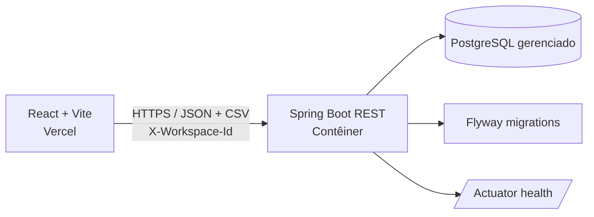

# LedgerLens

> **Conciliação financeira mais clara.** O LedgerLens importa lançamentos de um ERP e de um extrato bancário, aplica regras explícitas de correspondência e apresenta itens conciliados, divergentes e ausentes.

[](https://github.com/Willitonlima/ledgerlens/actions/workflows/verify.yml)

**Demo:** [Adicionar URL pública da demonstração](https://example.com)  
**Imagens:** substitua os marcadores abaixo por capturas sem dados financeiros reais.

| Visão geral | Resultado da conciliação |
|---|---|
| `` | `` |

## O que o projeto faz

- Importa CSVs de ERP e banco, valida os registros e associa cada importação ao workspace atual.
- Concilia os lotes mais recentes de cada origem e mostra correspondências, divergências e lançamentos sem par.
- Filtra/pagina resultados e exporta CSV com proteção contra fórmulas.
- Permite excluir os dados do workspace atual; os dados também expiram conforme a política de retenção.

## Arquitetura



O frontend é uma SPA estática. Em produção, `VITE_API_URL` aponta para a origem do backend; localmente, o Vite encaminha `/api` para `localhost:8080`. O backend usa Spring Data JPA, Flyway e PostgreSQL. `docker-compose.yml` fornece somente o PostgreSQL para desenvolvimento local.

## Stack e estrutura

- **Backend:** Java 21 conforme `backend/pom.xml`, Spring Boot 4.0.9 (Spring Framework 7.0.10), Maven, JPA, Flyway, PostgreSQL.
- **Frontend:** React, Vite, Tailwind CSS, npm, Vitest e Testing Library.
- **Testes backend:** JUnit/Spring Boot Test e Testcontainers; os testes de integração precisam de Docker.
- **Fontes:** Newsreader e Public Sans empacotadas localmente, sem buscar fontes de terceiros em runtime.

```text
backend/src/main/java/com/ledgerlens/
├── domain/           # entidades e enums
├── application/      # importação, validação e conciliação
├── infrastructure/   # persistência Spring Data
├── presentation/     # REST e tratamento de erros
└── config/           # CORS, workspace e propriedades
frontend/src/
├── api/              # cliente HTTP e workspace
├── components/       # importação, métricas e resultados
├── hooks/
└── utils/
```

## Regras de conciliação e valores

1. A execução usa o lote mais recente do ERP e o lote mais recente do banco para o workspace.
2. Prioriza referência externa normalizada **e valor**; em seguida, **data e valor exatos**.
3. Para candidatos aproximados, considera tolerâncias de data/valor e similaridade da descrição. O resultado pode ser `MATCHED`, `DIVERGENT` ou `MISSING`; cada lançamento bancário pode ser usado uma única vez por execução.
4. Valores CSV são lidos como quantias não negativas. Não se infere débito/crédito nem se inverte o sinal por origem. A diferença apresentada/exportada é **ERP − banco**: positiva significa ERP maior; negativa significa banco maior; zero significa igualdade. Divergências toleradas ainda podem ser exibidas como correspondência, conforme as regras e parâmetros atuais.
5. Configuração padrão: tolerância de data de 3 dias, tolerância de valor `0.01` e similaridade mínima de descrição `0.6`. A combinação exata por data/valor não depende de semelhança textual.

Os parâmetros ficam em `backend/src/main/resources/application.yml`, sob `ledgerlens.reconciliation`. Ajuste-os com testes e dados representativos antes de tratar os resultados como decisão contábil.

## API

Todas as rotas `/api/v1` exigem `X-Workspace-Id` com UUID.

| Método | Rota | Descrição |
|---|---|---|
| `POST` | `/api/v1/batches/upload?sourceType=ERP` ou `BANK` | multipart com campo `file` |
| `POST` | `/api/v1/reconciliations/execute` | executa a conciliação |
| `GET` | `/api/v1/reconciliations/latest` | resultado paginado; aceita `status`, `page`, `size` |
| `GET` | `/api/v1/reconciliations/latest/export` | exporta resultado CSV |
| `DELETE` | `/api/v1/workspace` | exclui os dados do workspace (`204`) |
| `GET` | `/actuator/health` | healthcheck sem detalhes operacionais |

## Rodar localmente

### Pré-requisitos

- Java/JDK **21** (mesma versão declarada no POM), Docker Desktop e Node.js 22+ com npm.
- O Maven Wrapper (`mvnw`/`mvnw.cmd`) baixa a distribuição Maven especificada pelo projeto.

### PostgreSQL

Na raiz do repositório:

```bash
cp .env.example .env
# Defina uma senha local em POSTGRES_PASSWORD e SPRING_DATASOURCE_PASSWORD no .env.
docker compose up -d
```

O Compose cria um PostgreSQL de desenvolvimento em `localhost:5432`. O arquivo `.env` é ignorado pelo Git; nunca reutilize a senha local em produção.

### Backend

Linux/macOS:

```bash
cd backend
export SPRING_DATASOURCE_URL=jdbc:postgresql://localhost:5432/ledgerlens
export SPRING_DATASOURCE_USERNAME=ledgerlens
export SPRING_DATASOURCE_PASSWORD='<a mesma senha local definida no .env>'
./mvnw spring-boot:run
```

Windows PowerShell:

```powershell
Set-Location backend
# Se o caminho do perfil do Windows tiver espaços, use um cache Maven sem espaços.
$env:MAVEN_USER_HOME = 'C:\m2cache'
$env:SPRING_DATASOURCE_URL = 'jdbc:postgresql://localhost:5432/ledgerlens'
$env:SPRING_DATASOURCE_USERNAME = 'ledgerlens'
$env:SPRING_DATASOURCE_PASSWORD = '<a mesma senha local definida no .env>'
.\mvnw.cmd spring-boot:run
```

O Flyway cria/atualiza o schema. Se criar `C:\m2cache`, use o mesmo `MAVEN_USER_HOME`
nos próximos comandos do wrapper. Testes:

```bash
# Linux/macOS
cd backend && ./mvnw test

# Windows PowerShell (a partir da raiz)
Set-Location backend
$env:MAVEN_USER_HOME = 'C:\m2cache'
.\mvnw.cmd test
```

Os testes de integração usam Testcontainers e exigem Docker em execução.

### Frontend

Em outro terminal:

```bash
cd frontend
npm ci
npm run dev
```

A aplicação abre em `http://localhost:5173` e o proxy do Vite encaminha `/api` ao backend local. Verificações:

```bash
npm test
npm run build
```

Os CSVs de exemplo incluem correspondências, divergência e lançamentos ausentes, com mais de 20 resultados para permitir exercitar a paginação.

## Deploy

Arquitetura recomendada: **frontend Vercel + backend contêiner + PostgreSQL gerenciado**. O backend não deve depender do PostgreSQL local do Compose em produção.

### 1. PostgreSQL gerenciado e backend

Crie primeiro um PostgreSQL gerenciado no provedor escolhido. Configure backup, TLS/SSL, região compatível, política de retenção e credenciais próprias; use a URL JDBC e os parâmetros TLS recomendados pelo provedor. Não publique credenciais no Git, em imagens Docker, no frontend ou em logs.

O Dockerfile está em `backend/Dockerfile` e usa build multi-stage, Maven Wrapper, Java 21, JRE enxuto, usuário não-root, healthcheck e opções de memória que respeitam o limite de memória do contêiner. Defina também um limite de memória no provedor (ou, em teste local, `docker run --memory=512m ...`); `MaxRAMPercentage=75` reserva margem para memória nativa. O contêiner usa o perfil Spring `prod`.

Variáveis obrigatórias do backend:

| Variável | Valor |
|---|---|
| `SPRING_DATASOURCE_URL` | URL JDBC do PostgreSQL, por exemplo `jdbc:postgresql://HOST:5432/DB?sslmode=require` (siga a documentação do provedor) |
| `SPRING_DATASOURCE_USERNAME` | usuário do banco |
| `SPRING_DATASOURCE_PASSWORD` | senha do banco, armazenada como secret no provedor |
| `ALLOWED_ORIGINS` | origem exata da SPA, por exemplo `https://SEU-PROJETO.vercel.app`; múltiplas origens separadas por vírgula, sem `*` |
| `SPRING_PROFILES_ACTIVE` | `prod` (já definido na imagem) |
| `PORT` | porta atribuída pelo host quando aplicável; o Spring aceita `PORT`, com fallback `8080` |

**Render (opcional):** o `render.yaml` descreve somente o serviço Web Docker e o healthcheck `/actuator/health`. Crie ou selecione separadamente um PostgreSQL gerenciado e informe as quatro variáveis secretas/por ambiente no painel do Render. O blueprint não provisiona banco pago. O host fornece `PORT`.

**Alternativas:** Railway pode executar o serviço Docker e disponibilizar PostgreSQL gerenciado; configure as mesmas variáveis e a URL JDBC (não use a URL interna Railway sem adaptá-la ao formato JDBC). No Fly.io, publique a imagem com `fly deploy` e use PostgreSQL gerenciado externo ou um serviço Postgres Fly; configure secrets com `fly secrets set` e conectividade/TLS apropriados. Recursos, custos, nomes de variáveis e disponibilidade variam por plano/região; confirme nos documentos do provedor antes do deploy.

### Ordem do primeiro deploy

1. Crie um PostgreSQL gerenciado e anote a URL JDBC, usuário e senha.
2. Publique o backend no Render (ou alternativa) e configure as variáveis do banco de dados.
3. Copie a URL pública do backend para `VITE_API_URL` nas variáveis de build da Vercel e substitua o host placeholder no `connect-src` do CSP em `frontend/vercel.json`.
4. Publique o frontend na Vercel com diretório raiz `frontend`.
5. Atualize `ALLOWED_ORIGINS` no backend para a URL pública final da Vercel e redeploy o backend.

### 2. Frontend na Vercel

Importe o repositório na Vercel e defina **Root Directory** como `frontend`. `frontend/vercel.json` configura `npm ci`, `npm run build`, saída `dist`, fallback de rotas SPA e cabeçalhos de segurança. A Vercel serve arquivos existentes (incluindo `/assets`) antes de aplicar o rewrite de fallback.

Defina `VITE_API_URL` no projeto Vercel **antes do build** como a origem HTTPS do backend, sem `/api` no final (por exemplo, `https://SEU-BACKEND.onrender.com`). A variável é incorporada ao JavaScript público: nunca coloque segredos nela.

Antes de publicar, substitua `https://SEU-BACKEND.onrender.com` no CSP de `frontend/vercel.json` pelo host real do backend, exatamente compatível com `VITE_API_URL`. A CSP é intencionalmente um placeholder e pode bloquear chamadas à API até essa substituição. Revise também `ALLOWED_ORIGINS` no backend com a URL real do frontend. HSTS deve ser usado apenas para domínio servido exclusivamente por HTTPS.

### Variáveis de ambiente

- `frontend/.env.example` ilustra `VITE_API_URL`; copie para `frontend/.env` local e substitua o host. Arquivos `.env` reais não devem ser commitados.
- As variáveis de banco e CORS são apenas de runtime do backend. Use o gerenciador de secrets do host.
- `ALLOWED_ORIGINS` deve listar a origem pública completa, não um caminho e nem `*`.

## Privacidade, isolamento e retenção

- O cliente cria um UUID de workspace no navegador e o envia como `X-Workspace-Id`; o backend usa esse identificador para isolar consultas. **Esse UUID não é autenticação nem autorização de usuário**: não use o app com dados financeiros sensíveis ou multiusuário sem adicionar identidade, controle de acesso e revisão de segurança.
- Os registros importados são persistidos no PostgreSQL e ficam sujeitos à política de retenção. A retenção padrão é de 24 horas (`ledgerlens.retention-hours`); a limpeza periódica é configurada em `ledgerlens.cleanup-interval-ms`. O endpoint de exclusão remove os dados do workspace corrente.
- Configure backup e expiração também no provedor de banco. Expiração na aplicação não apaga cópias de backup imediatamente. Defina política de retenção e descarte alinhada às obrigações do seu negócio.
- Não envie arquivos financeiros reais para uma demo pública. Use dados sintéticos e remova identificadores, nomes e informações de conta.

## Segurança e decisões técnicas

- O matching usa índices `HashMap` para procurar chaves exatas por referência e data/valor, mantendo o caminho comum linear em relação aos lançamentos (`O(n)`); a busca por tolerância usa índices ordenados (`TreeMap`).
- Valores monetários são representados por `BigDecimal`, evitando erros de ponto flutuante.
- A importação é transacional: lote e lançamentos persistem juntos ou sofrem rollback juntos.
- O hash SHA-256 do arquivo junto à origem torna reenvios idempotentes dentro do workspace, sem duplicar importações.
- `workspace_id` particiona consultas e exclusões por espaço de trabalho; o UUID do navegador não autentica o visitante.
- `backend/Dockerfile` separa build/runtime, executa como UID não-root e limita heap pela memória reconhecida pelo cgroup; configure o limite real de memória na plataforma.
- Actuator expõe somente health, sem detalhes; healthcheck Docker/Render consulta `/actuator/health`.
- Vercel aplica CSP (com host de API a substituir), HSTS, `nosniff`, proteção contra framing, política de referrer e permissões restritas. CSP precisa ser revisada se forem adicionados scripts, fontes ou endpoints externos.
- `.dockerignore` remove diretórios de build, dependências locais, VCS, env files e chaves do contexto Docker.
- CI em `.github/workflows/verify.yml` testa/verifica backend com Java 21 e testa/builda frontend com Node 22; Dependabot acompanha Maven, npm e Actions.
- O backend compila e executa com Java 21 em local, CI e contêiner. Spring Boot 4.0.9 gerencia Spring Framework 7.0.10, acima das versões corrigidas para CVE-2026-47884 e CVE-2026-47890; suas dependências e módulos seguem o BOM do Boot. Valide a compatibilidade do runtime e da plataforma antes do deploy.

## Limitações conhecidas

- A conciliação é determinística e baseada nos campos/tolerâncias implementados; não substitui validação contábil.
- O identificador de workspace é apenas um mecanismo de isolamento por cliente, não um mecanismo de autenticação.
- Demo, imagens e domínio/CSP são placeholders que precisam ser preenchidos pelo responsável pelo deploy.
